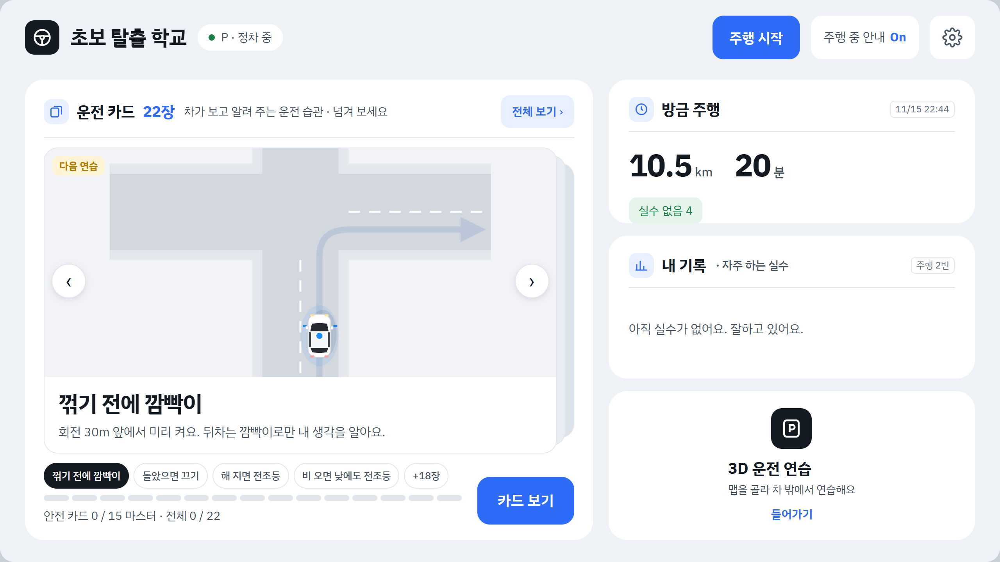

# 초보 탈출 학교

> (앱 한 줄 소개)

- 팀: **동고동락** · 현대자동차그룹 차량용 앱 개발 공모전 출품작
- 플랫폼: Pleos Connect (Android Automotive, API 34) · Kotlin

## 시연 영상

[▶ 시연 영상 보기 (demo/초보탈출학교_demo.mp4)](demo/초보탈출학교_demo.mp4)

## 주요 기능

| 기능 | 설명 |
|---|---|
| (기능 1) | |
| (기능 2) | |

<!-- 화면 이미지는 docs/images/ 에 넣고 아래처럼 연결 -->
<!--  -->

## Pleos SDK 사용

| SDK | 도메인 / 기능 | 쓰는 곳 |
|---|---|---|
| Vehicle | | |
| TextToSpeech | | |

## 테스트 환경

| 항목 | 버전 |
|---|---|
| Vehicle SDK | |
| AVD | Pleos Connect Emulator v2.1.0 (API 34, Automotive) |
| Android Gradle Plugin / Gradle | |
| Kotlin / JDK | |

> 일반 폰이나 기본 에뮬레이터에서는 동작하지 않습니다. Vehicle Service가 들어 있는 **Pleos Connect 전용 AVD**가 필요합니다.

## 빌드·실행

1. Pleos Connect 에뮬레이터 준비 (Android Studio SDK Manager → Pleos Connect system image, Automotive AVD, Cold boot)
2. Android Studio → Open → 이 저장소 폴더 → Gradle Sync (Windows는 경로에 한글이 없어야 빌드됨, Gradle JDK 17)
3. Pleos Connect AVD를 대상으로 Run ▶
4. 차량 값 바꿔 보기: `adb forward tcp:8088 tcp:8088` → 브라우저에서 http://127.0.0.1:8088/ (Virtual Console)

## 코드 구조

```
(소스 폴더 구조)
```

---

© 2026 Team 동고동락
