# 초보 탈출 학교

> 차가 직접 가르치는 초보 운전 학교 — 깜빡이·브레이크·기어를 차량 신호로 채점하고, 단원을 하나씩 깨며 초보를 졸업합니다.

- 팀: **동고동락** · 현대자동차그룹 차량용 앱 개발 공모전 출품작
- 플랫폼: Pleos Connect (Android Automotive, API 34) · Kotlin
- **APK:** [최적화(제출 기본)](apk/) · [3D 원본](apk/) · **웹 3D:** [`web/`](web/) · **시연 영상:** [demo/](demo/) · **실행:** [심사위원 빠른 실행](#심사위원-빠른-실행-3단계)


> [!IMPORTANT]
> 시연에 쓰는 차량 신호(기어·브레이크·핸들·깜빡이·와이퍼·조명·공조)는 **Pleos Connect 에뮬레이터의 Virtual Console**에서 바꾼 값입니다. 앱은 실제 Pleos Vehicle SDK로 그 값을 읽습니다. 앱 안에 가짜 신호를 만드는 코드는 없습니다.

## 목차

1. [왜 만들었나](#왜-만들었나)
2. [핵심 구조: 학교](#핵심-구조-학교)
3. [주요 기능](#주요-기능)
4. [화면 둘러보기](#화면-둘러보기)
5. [3D 운전 연습](#3d-운전-연습--차-밖에서-미리-달려-보기)
6. [APK 두 가지와 웹 버전](#apk-두-가지와-웹-버전--에뮬레이터-렉-때문에-나눴습니다)
7. [차량 신호로 어떻게 채점하나](#차량-신호로-어떻게-채점하나)
8. [주행 중에는 한 줄만](#주행-중에는-한-줄만)
9. [사용한 Pleos SDK](#사용한-pleos-sdk)
10. [심사위원 빠른 실행 (3단계)](#심사위원-빠른-실행-3단계)
11. [테스트 환경](#테스트-환경)
12. [코드 구조](#코드-구조)
13. [알려진 한계](#알려진-한계)

## 왜 만들었나

면허를 막 딴 운전자에게 무서운 순간은 속도를 낼 때가 아니라 **판단하고 조작하는 순간**입니다. 언제 깜빡이를 켜는지, 다 돈 뒤에 깜빡이를 껐는지, 브레이크 없이 기어를 넣지는 않았는지 같은 것들입니다.

초보가 이런 실수를 알게 되는 길은 두 가지뿐입니다.

- **옆자리 가족이 지적해 준다.** 그러다 연수가 다툼이 되기 쉽습니다.
- **혼자 달리며 모르고 지나간다.**

휴대폰 운전 앱은 GPS와 가속도로 급가속·급정지만 추정합니다. **깜빡이·브레이크 페달·기어·핸들 각도는 차만 압니다.** 그래서 차가 선생님이 되는 학교를 만들었습니다.

## 핵심 구조: 학교

단원 → 기술 → 미리 배우기 카드로 이어지는 학습 경로가 홈에 깔립니다. 실제 주행에서 받은 코치와 점수가 기술마다 별(1~3개)을 채웁니다. 앞 단원 시험을 통과해야 다음 단원이 열리고, 합격 주행을 쌓으면 졸업합니다.

| 단원 | 배우는 것 | 차가 읽는 신호 |
|---|---|---|
| 1. 출발과 정차 | 브레이크 밟고 D, 브레이크 밟은 채 P | 기어, 브레이크 페달 |
| 2. 깜빡이 | 꺾기 전에 켜기, 켜고 잊지 않기, 좌회전 기다릴 때 켜기 | 방향지시등, 핸들 각도, 주행거리 |
| 3. 날씨와 밤 | 빗길 전조등, 밤길 상향등·실내등, 김 서림 | 와이퍼, 전조등·상향등·실내등, 공조 |
| 4. 주정차 규칙 | 소화전·버스정류소·횡단보도·어린이보호구역 피해 세우기 | 기어 P 순간의 위치 |
| 5. 졸업 시험 | 합격 주행 3번 | — |

## 주요 기능

| 기능 | 설명 |
|---|---|
| **주행 성적표** | 기어 D로 출발하면 수업 시작, P로 세우면 100점 만점 성적표. 출발 20 · 깜빡이 켜기 40 · 깜빡이 끄기 20 · 정차 20, 80점 합격 |
| **주행 중 코치** | 깜빡이 없이 꺾음, 깜빡이 방치, 브레이크 없이 D, P가 아닌데 문 열림, 빗길·밤길·김 서림을 그 순간 음성과 한 줄로 알려 줌 |
| **내비 위 코치 배너** | 순정 내비를 앞에 띄워 둬도 코치가 내비 위에 짧은 배너로 뜨고, 주행 기록도 끊기지 않음 |
| **주정차 판정** | P를 넣는 순간 단속 구역 근처인지 판정해 🔴🟠🟢 카드와 음성으로 알려 주고, 가까운 공영주차장으로 내비 경로를 잡음 |
| **3D 운전 연습** | 놓친 카드를 정차 중 3D 맵 23개(주차장·도시·고속도로·야간·빗길)에서 핸들·기어·깜빡이로 다시 연습 |
| **기록·배지·미션** | 성적표 → 그 순간의 코치 → 관련 기술로 이어 들어가 복습. 단계형 배지, 오늘의 목표, 주 단위 연속 주행, 졸업장 |


## 화면 둘러보기

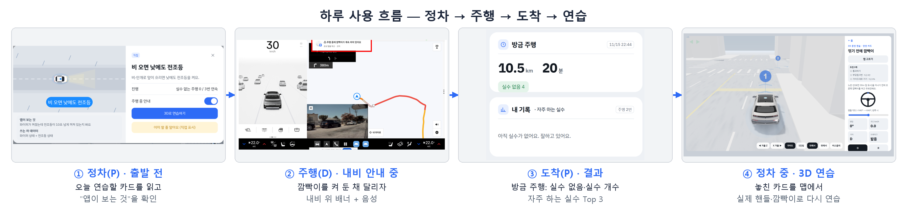

<table>
<tr>
<td width="50%"><br><b>홈 (P · 정차 중)</b><br>다음 연습할 운전 카드, 방금 주행, 내 기록</td>
<td width="50%">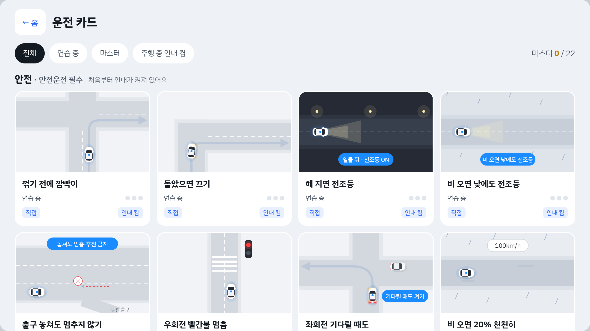<br><b>운전 카드</b><br>차가 보고 알려 주는 운전 습관 22장, 연습 중·마스터 표시</td>
</tr>
<tr>
<td>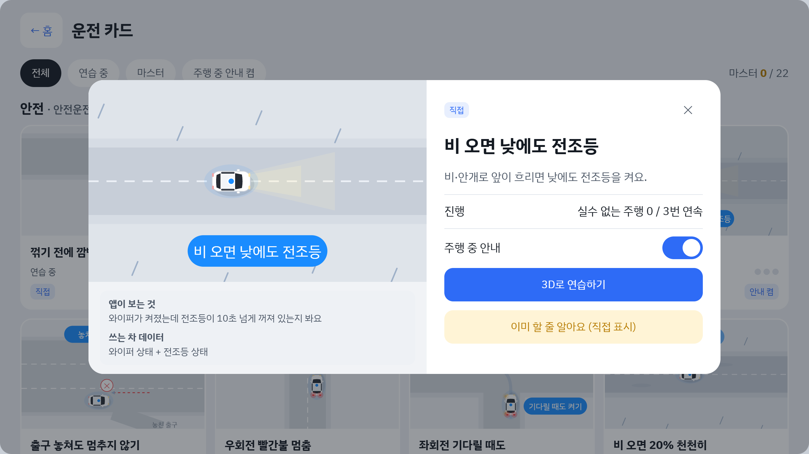<br><b>카드 상세</b><br>"앱이 보는 것"과 "쓰는 차 데이터"를 그대로 보여 줌</td>
<td>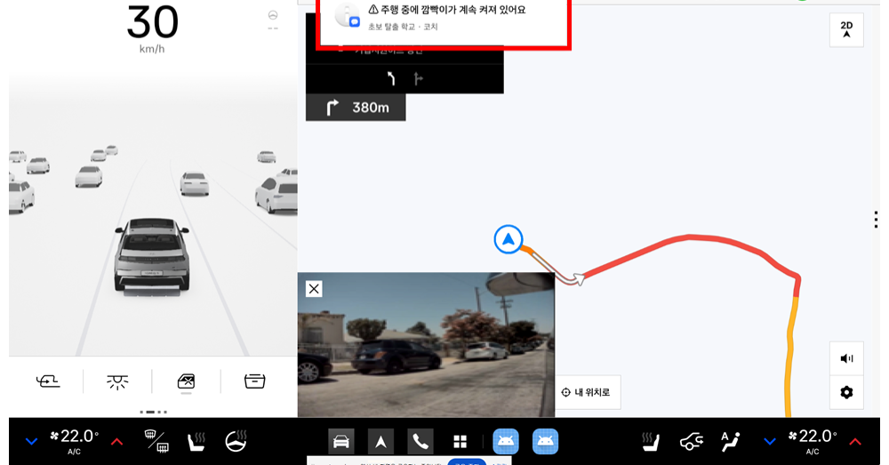<br><b>주행 중 (D · 내비 안내 중)</b><br>순정 내비 위에 뜨는 코치 배너 (빨간 테두리)</td>
</tr>
</table>

## 3D 운전 연습 — 차 밖에서 미리 달려 보기

놓친 운전 카드를 **정차 중 3D 맵에서 다시 연습**합니다. 핸들 각도·기어·브레이크·깜빡이를 실제 차처럼 조작하고, 맵마다 "도전 3개"(통과 · 부딪힘 0번 · 가이드대로 가기)로 별을 받습니다.

- **맵 23개 · 4단계:** 1단계 안전 기본 → 2단계 교차로·날씨 → 3단계 고속도로 → 4단계 운전 센스
- **환경:** 주차장 · 도시 교차로 · 고속도로 합류·출구 · 야간 · 빗길 · 김 서림 · 방지턱
- **시점 5가지:** 가이드 · 1인칭 · 뒤에서 · 위에서 · 비스듬히, 좌우 거울
- **카드와 연결:** 운전 카드 상세의 [3D로 연습하기]에서 그 카드의 맵이 바로 열립니다

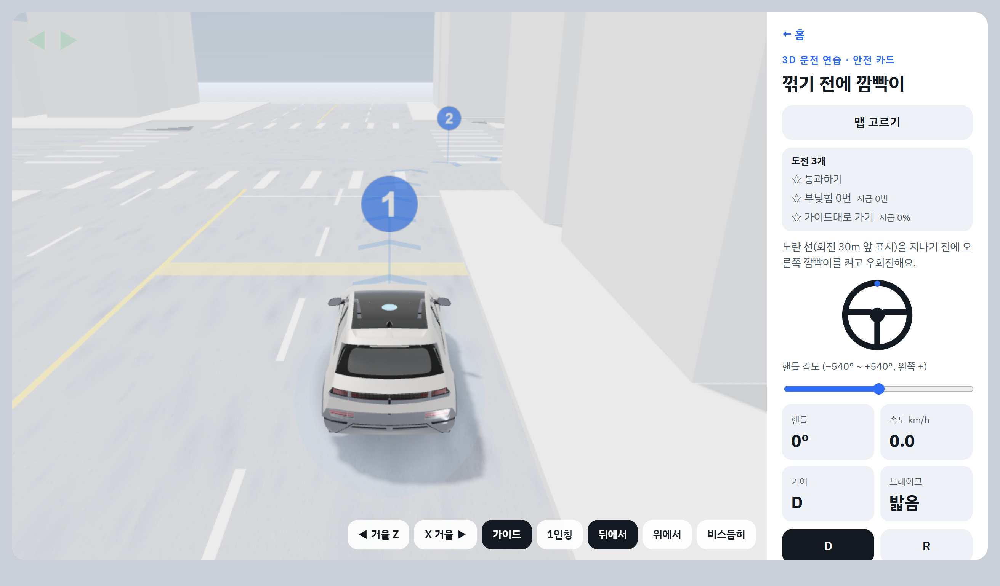

<sub>3D 연습 화면: 왼쪽은 맵, 오른쪽은 도전 3개·목표·핸들 각도·속도·기어·브레이크</sub>

### 연습 맵 예시 (23개 중 10개)

<table>
<tr>
<td width="50%">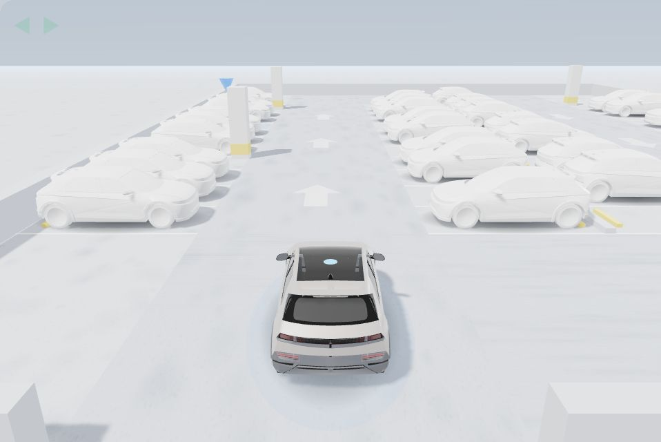<br><b>주차장 · 세우고 P 넣기</b> <sub>1단계</sub><br>파란 칸에 뒤로 넣고, 브레이크를 밟은 채 멈추기</td>
<td width="50%">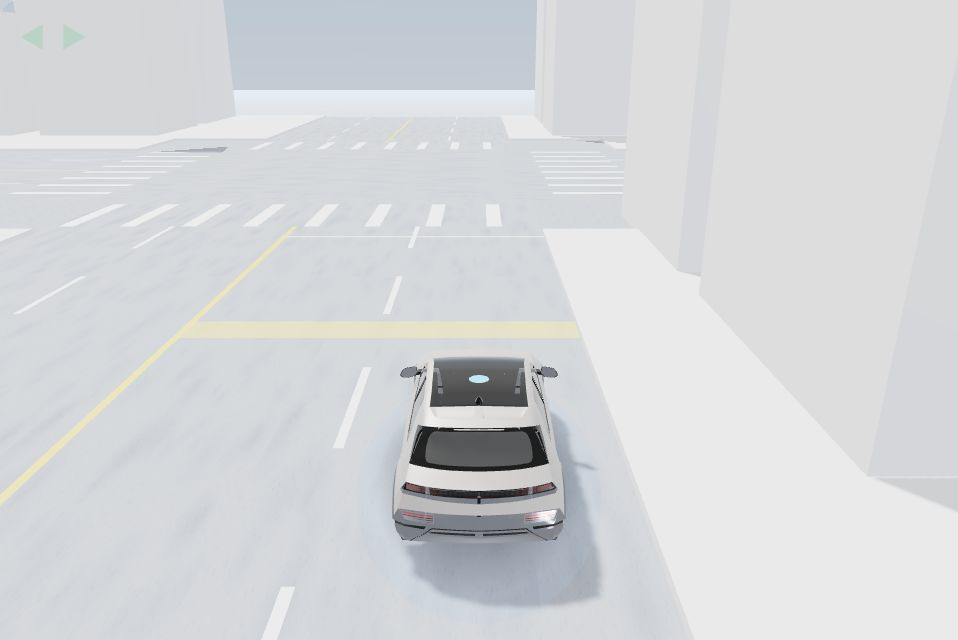<br><b>도시 교차로 · 꺾기 전에 깜빡이</b> <sub>1단계</sub><br>회전 30m 앞 노란 선 전에 깜빡이 켜고 우회전</td>
</tr>
<tr>
<td width="50%">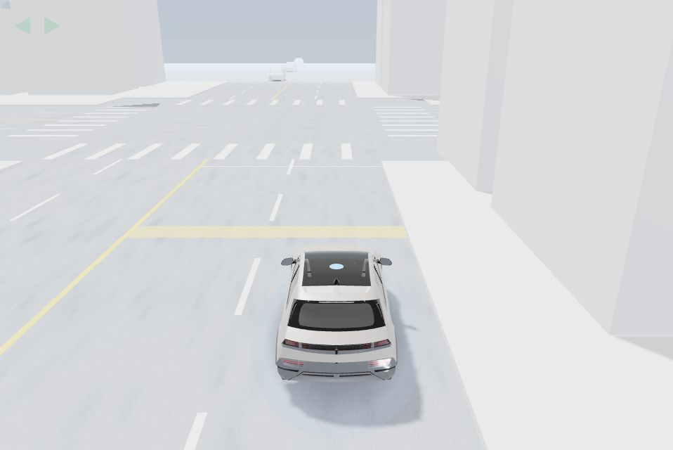<br><b>교차로 · 마주 오는 차 · 좌회전 기다릴 때도</b> <sub>2단계</sub><br>마주 오는 차가 지나갈 때까지 깜빡이 켜고 대기</td>
<td width="50%">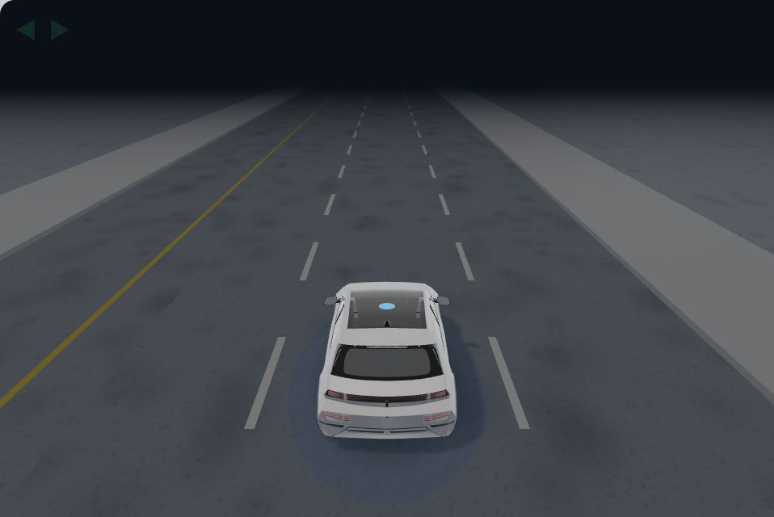<br><b>야간 · 해 지면 전조등</b> <sub>1단계</sub><br>밤길 출발 20m 안에 전조등 켜기</td>
</tr>
<tr>
<td width="50%">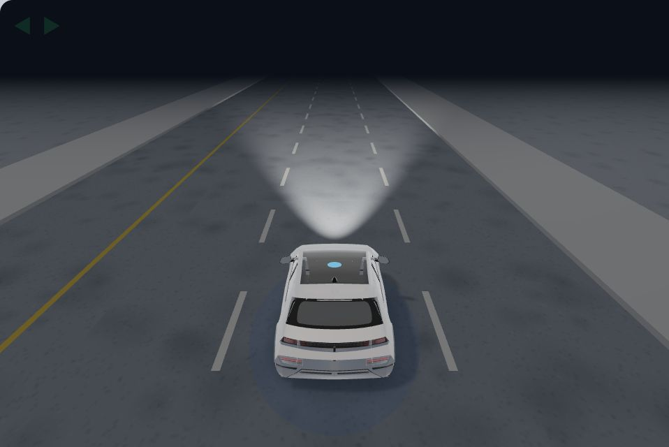<br><b>야간 · 양방향 · 마주 오면 상향등 끄기</b> <sub>2단계</sub><br>마주 오는 차가 40m 안에 들기 전에 상향등 끄기</td>
<td width="50%">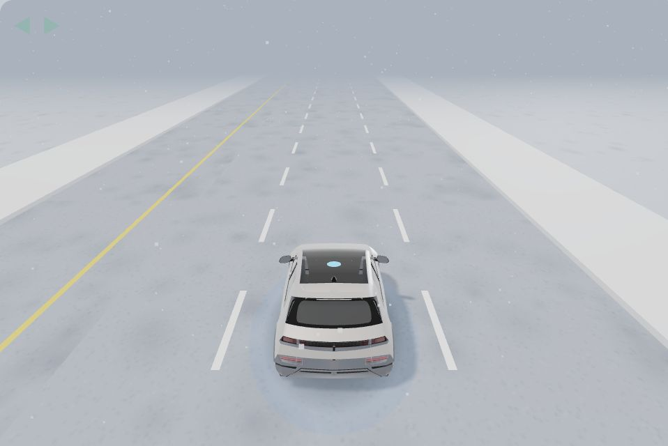<br><b>빗길 · 비 오면 낮에도 전조등</b> <sub>1단계</sub><br>20m 안에 와이퍼와 전조등 켜기</td>
</tr>
<tr>
<td width="50%">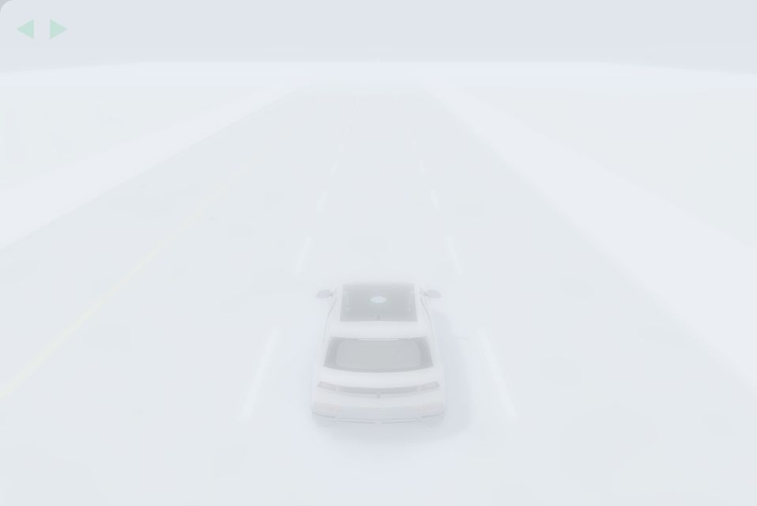<br><b>김 서림 · 김 서림 바로 없애기</b> <sub>2단계</sub><br>25m 안에 김 서림 제거 켜기</td>
<td width="50%">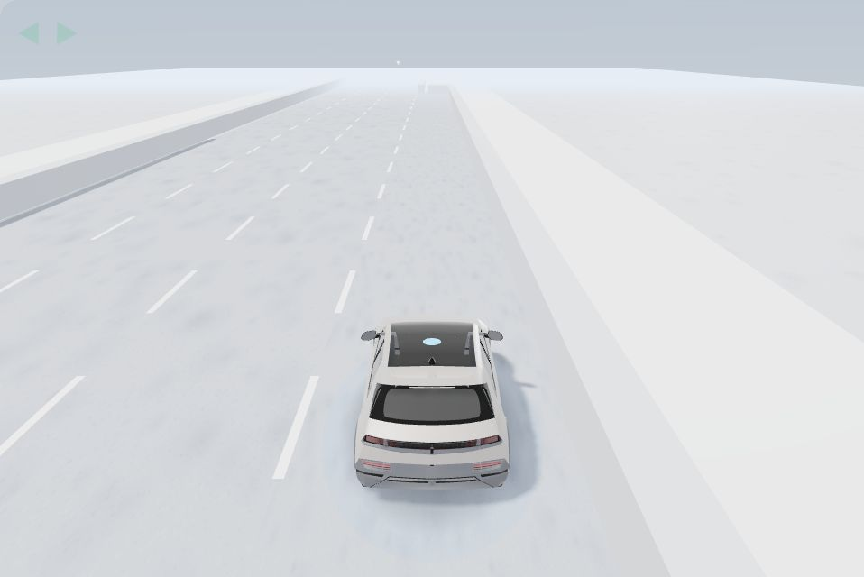<br><b>고속도로 합류 · 합류 속도 맞추기</b> <sub>3단계</sub><br>가속차로 끝나기 전 본선 차 사이로, 60m부터 브레이크 금지</td>
</tr>
<tr>
<td width="50%">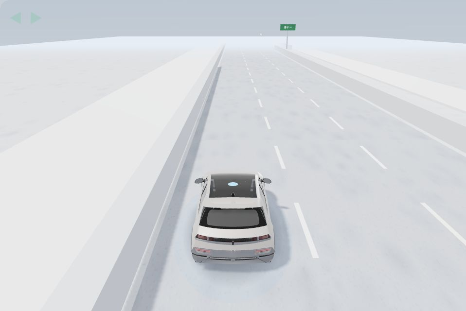<br><b>고속도로 출구 · 출구는 미리 오른쪽</b> <sub>3단계</sub><br>맨 왼쪽 차로에서 한 차로씩 옮겨 출구로</td>
<td width="50%">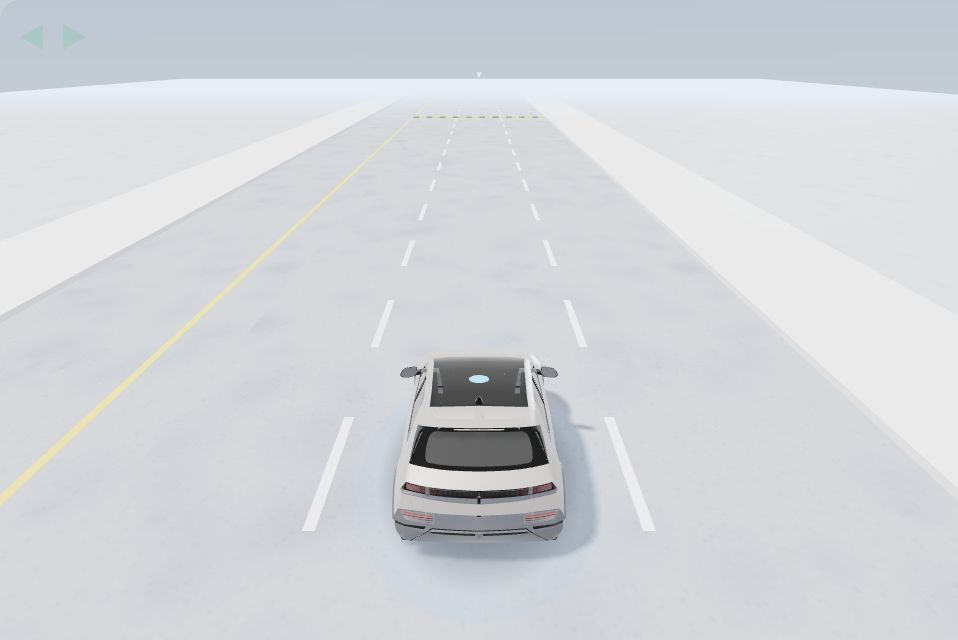<br><b>생활 도로 · 방지턱 살살 넘기</b> <sub>4단계</sub><br>방지턱 앞에서 브레이크를 짧게 여러 번</td>
</tr>
</table>

## APK 두 가지와 웹 버전 — 에뮬레이터 렉 때문에 나눴습니다

**결론: 기능은 같고, 3D와 애니메이션을 그리는 방식만 다릅니다.** Pleos Connect 에뮬레이터에서 앱 안 3D·애니메이션이 크게 끊겨서, 심사·시연용 기본 APK는 3D 맵을 **사진**으로, 애니메이션을 **끔**으로 바꿨습니다. 움직이는 3D는 원본 APK와 웹 버전에서 그대로 볼 수 있습니다.

| 무엇 | 파일 | 3D 연습 | 애니메이션 | 언제 쓰나 |
|---|---|---|---|---|
| **① 최적화 APK (제출 기본)** | [`apk/동고동락_초보탈출학교_release.apk`](apk/) | 맵 23개를 **사진**으로 (맵 고르기·목표 설명은 그대로). 사진마다 "3D를 찍은 사진 · 움직이는 3D는 원본 APK와 웹에서" 안내가 뜸 | 끔 | 에뮬레이터 심사·시연. 렉 없이 모든 기능 확인 |
| **② 3D 원본 APK** | [`apk/동고동락_초보탈출학교_3D원본_release.apk`](apk/) | **실제 3D** (핸들·기어·브레이크로 운전) | 켬 (눌림·별·축하) | 실차 또는 빠른 기기에서 원래 경험 보기. 에뮬레이터에서는 끊김 |
| **③ 웹 버전 (HTML)** | [`web/`](web/) | **실제 3D**, PC 브라우저에서 부드럽게 | 켬 | 설치 없이 3D 연습·운전 카드를 바로 체험 |

- **웹 여는 법:** 저장소를 받은 뒤 크롬으로 엽니다(인터넷 필요, three.js를 CDN에서 불러옴).
  - 3D 운전 연습: `web/plan-school-parking-sim-3d.html`
  - 홈 + 운전 카드: `web/plan-school-drive-cards-prototype.html`
- **웹 조작 (키보드):** ← → 핸들 · 스페이스 브레이크 · Q/E 깜빡이 · H 전조등 · J 상향등 · W 와이퍼 · D/R 기어 · C 시점 바꾸기 · Z/X 거울 · Backspace 처음부터. 화면 버튼으로도 조작할 수 있습니다
- 두 APK와 웹은 **같은 웹 원본**에서 나옵니다. `tools/school_web/mk_assets.py`가 웹 원본을 앱 assets로 옮깁니다.
  - `PHOTOS = True`: 사진판(①)
  - `PHOTOS = False`: 3D판(②)
  - 앱 애니메이션은 `SchoolUi.kt`의 `ANIMATIONS` 값으로 켜고 끕니다.

### 왜 에뮬레이터에서 끊기나 (측정값)

| 어디서 | 무엇을 | 결과 |
|---|---|---|
| 에뮬레이터 · 앱 WebView | 3D 맵 화면 갱신 | 초당 5~8장 |
| 에뮬레이터 · 앱 WebView | **3D가 없는 홈 화면** 갱신 | 초당 7~8번 |
| 에뮬레이터 · 앱 WebView | 3D 한 장 계산·그리기 | 6.6~10ms (60장 기준 16.7ms 안) |
| PC 크롬 · 같은 3D 웹 | 화면 갱신 / 한 장 | 초당 60장 / 약 1ms |

- **3D 계산은 제때 끝납니다.** 3D가 없는 홈 화면도 똑같이 느립니다. 그래서 무거운 3D 탓이 아니라 **에뮬레이터가 화면을 내보내는 길**이 좁은 것으로 봅니다.
- **에뮬레이터 그래픽은 "번역"을 거칩니다.** `OpenGL ES Translator`가 안드로이드 그래픽 명령을 PC 그래픽 명령으로 바꿉니다.
- **에뮬레이터 화면이 큽니다.** 2560×1440으로 한 장에 약 370만 점을 칠합니다.
- **실차에서는 재 보지 못했습니다.** 실차는 그래픽을 번역하지 않고 바로 그리므로 더 부드러울 것으로 예상합니다. 다만 확인된 사실은 아닙니다.

## 차량 신호로 어떻게 채점하나

예: 단원 2 "꺾기 전에 깜빡이 켜기"

| 순간 | 앱이 보는 것 | 결과 |
|---|---|---|
| 핸들이 일정 각도 넘게 돌기 시작함 | 그 직전에 방향지시등이 켜져 있었나 | 켜져 있으면 깜빡이 켜기 점수, 아니면 "꺾기 전에 깜빡이" 코치 |
| 회전이 끝나고 핸들이 돌아옴 | 방향지시등이 꺼졌나, 켜진 채 계속 달리나 | 일정 거리 넘게 켜져 있으면 "깜빡이가 계속 켜져 있어요" 코치 |
| 기어 P | 이번 주행의 모든 판정 | 성적표, 기술별 별 갱신 |

판정 기준은 앱 안 미리 배우기 카드에서도 그대로 설명합니다. 사용자가 점수를 납득할 수 있게 하기 위해서입니다.


### 하루 흐름

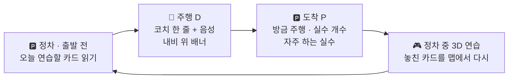

### 판정 흐름 (예: 꺾기 전에 깜빡이)

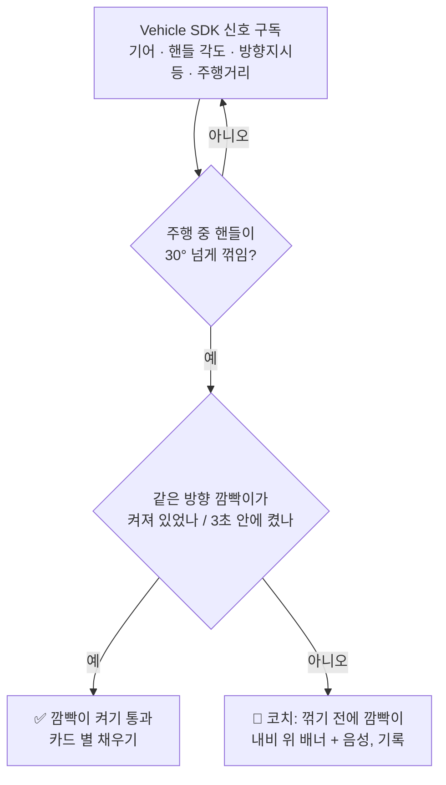

### 판정 근거를 숨기지 않습니다

모든 코치에 **앱이 보는 것**과 **근거 조문(도로교통법 등)**을 붙였습니다. 숫자 중 우리가 정한 값은 `[가정]`으로 표시합니다.

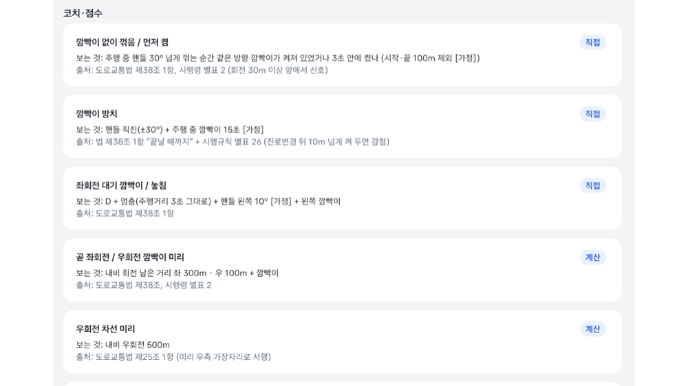

## 주행 중에는 한 줄만

- 주행 중(D·R·N)에는 어느 화면에 있든 **큰 글씨 코치 한 줄**만 남습니다.
- 메뉴·학습 경로·기록은 **기어 P일 때만** 엽니다.
- P로 돌아오면 성적표가 먼저 뜹니다.

## 사용한 Pleos SDK

| SDK | 버전 | 앱에서 하는 일 |
|---|---|---|
| Vehicle | 2.3.2 | 기어·브레이크·핸들 각도·방향지시등·주행거리·문·와이퍼·조명·좌석·창문·공조를 읽어 채점과 코치 |
| NaviHelper | 3.0.5 | 순정 내비 경로·회전 정보 수신, 주정차 판정 뒤 주차장 경로 요청 |
| FusedLocation | 1.1.3 | P를 넣은 순간의 위치로 주정차 판정 |
| TextToSpeech | 3.3.1 | 코치 음성 안내 |

요청하는 차량 권한은 `app/src/main/AndroidManifest.xml`에 있습니다.

## 심사위원 빠른 실행 (3단계)

1. **Pleos Connect 에뮬레이터 실행**
   - Android Studio SDK Manager에서 Pleos Connect system image를 설치합니다.
   - Automotive AVD(Pleos Connect v2.1.0)를 Cold boot로 켭니다.
2. **APK 설치·실행**
   ```bash
   adb install -r "apk/동고동락_초보탈출학교_release.apk"
   ```
   움직이는 3D를 보려면 `apk/동고동락_초보탈출학교_3D원본_release.apk`를 설치합니다(에뮬레이터에서는 끊김). 또는 `web/plan-school-parking-sim-3d.html`을 크롬으로 엽니다.
   앱 목록에서 **초보 탈출 학교**를 엽니다.
3. **차량 값 바꿔 보기 (Virtual Console)**
   - `adb forward tcp:8088 tcp:8088` 후 브라우저에서 http://127.0.0.1:8088/ 을 엽니다.
   - 순서: 브레이크 밟고 기어 D → 깜빡이 없이 핸들 돌리기(코치 확인) → 깜빡이 켜고 돌리기 → 기어 P(성적표 확인)

### 소스에서 빌드

- Android Studio → Open → 이 저장소 폴더 → Gradle Sync (Gradle JDK 17)
- Windows는 경로에 한글이 없어야 빌드됩니다.
- Pleos Connect AVD를 대상으로 Run ▶

## 테스트 환경

| 항목 | 값 |
|---|---|
| 에뮬레이터 | Pleos Connect Emulator v2.1.0 (API 34, Automotive) |
| 빌드 | Android Gradle Plugin 8.8.2, Gradle 8.10.2, Kotlin 2.0.0, JDK 17 |
| SDK 버전 | compileSdk 35 / targetSdk 35 / minSdk 28 |
| Pleos SDK 저장소 | `https://nexus-playground.pleos.ai/repository/maven-releases/` |

> 일반 폰이나 기본 에뮬레이터에서는 동작하지 않습니다. Vehicle Service가 들어 있는 **Pleos Connect 전용 AVD**가 필요합니다.

## 코드 구조

```
app/src/main/java/com/example/pleosstarter/
├── MainActivity.kt                 시작 화면
├── school/                         초보 탈출 학교
│   ├── SchoolActivity.kt           화면 전환(주행 중 한 줄 / P에서 메뉴)
│   ├── DriveSense.kt               차량 신호 구독
│   ├── TripScorer.kt · TurnJudge.kt  성적표 채점, 회전·깜빡이 판정
│   ├── Coach.kt · CoachBanner.kt   주행 중 코치 문구와 내비 위 배너
│   ├── *Detector.kt                깜빡이 방치·김 서림·빗길·좌석 열선 등 상황 감지
│   ├── LearningPath.kt · LearnScreens.kt  단원·기술·미리 배우기 카드
│   ├── SchoolBadges.kt · BadgeScreens.kt  배지
│   └── parking/                    주정차 판정(위치·구역·내비 연동)
└── signal/                         차량 신호 확인용 화면
```

## 알려진 한계

- **실차 검증은 아직 못 했습니다.** 모든 기능은 Pleos Connect 에뮬레이터와 Virtual Console로 확인했습니다.
- **차선 정보는 받을 수 없습니다.** 외부 앱에는 ADAS 차선·주변 차 정보가 열려 있지 않습니다. 그래서 차선 변경은 핸들 각도 + 방향지시등으로 추정합니다.
- **주정차 구역 데이터는 시연용 샘플 구역**입니다. 공공데이터 연동은 다음 단계입니다.
- **에뮬레이터에서는 3D가 끊깁니다.** 그래서 제출 기본 APK는 3D를 사진으로 바꿨습니다(위 "APK 두 가지와 웹 버전").
- **3D 원본 APK는 빌드만 하고 에뮬레이터 설치 확인은 하지 않았습니다.** 웹 원본은 2026-11-15 판입니다(최적화 APK보다 3D 맵 기능이 새것).
- **release APK는 debug 키로 서명**했습니다. 별도 서명 키 없이 바로 설치되게 하기 위해서입니다.
- **패키지 이름은 개발용 그대로**입니다(`com.example.pleosstarter`).

---

© 2026 Team 동고동락
